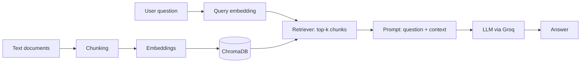

# RAG Pipeline with Groq, ChromaDB and Sentence Transformers

A simple, end-to-end **Retrieval-Augmented Generation (RAG)** pipeline in Python.
It loads text documents, splits them into chunks, stores their embeddings in a local vector database, and answers questions with an LLM, using only the retrieved context.

The goal of this project is to understand every step of a RAG system: from raw text to a grounded answer.

---

## How it works



**Indexing (once)**

1. **Load** – `.txt` files are loaded with LangChain's `TextLoader`.
2. **Chunk** – `RecursiveCharacterTextSplitter` splits the text into chunks of 1,000 characters with 200 characters overlap, so no sentence is lost at the edges.
3. **Embed** – each chunk is turned into a vector with the Sentence Transformers model `all-MiniLM-L6-v2` (runs locally, free).
4. **Store** – vectors, text and metadata are saved in a persistent **ChromaDB** collection.

**Querying (every question)**

5. **Embed the question** with the same model.
6. **Retrieve** the top-k most similar chunks (cosine similarity).
7. **Generate** – the question and the retrieved chunks are sent to an LLM on **Groq** (`openai/gpt-oss-20b`), which writes the answer.

---

## Tech stack

| Part | Tool |
|---|---|
| Language | Python 3.13 |
| Document loading & chunking | LangChain (`langchain-community`, `langchain-text-splitters`) |
| Embeddings | Sentence Transformers – `all-MiniLM-L6-v2` (local) |
| Vector database | ChromaDB (persistent, local) |
| LLM | Groq API – `openai/gpt-oss-20b` via `langchain-groq` |
| Config | `python-dotenv` |

---

## Project structure

```
rag-pipeline-groq/
├── RAG_Pipline.py              # full pipeline: load → chunk → embed → store → retrieve → generate
├── data/
│   └── text_files/
│       └── python_intro.txt    # example document
├── requirement.txt             # Python dependencies
└── .gitignore                  # keeps .env, venv and the vector store out of Git
```

The vector store is created automatically in `data/vector_store/` on the first run and is not committed.

---

## Setup

**1. Clone the repository**

```bash
git clone https://github.com/nazifakazimi24/rag-pipeline-groq.git
cd rag-pipeline-groq
```

**2. Create and activate a virtual environment**

```bash
python3 -m venv venv
source venv/bin/activate        # Windows: venv\Scripts\activate
```

**3. Install the dependencies**

```bash
pip install -r requirement.txt
```

**4. Add your Groq API key**

Create a free key at [console.groq.com](https://console.groq.com), then create a file called `.env` in the project folder:

```
GROQ_API_KEY=your-key-here
```

The `.env` file is ignored by Git, so your key is never uploaded.

---

## Run

```bash
python RAG_Pipline.py
```

The script builds the vector store (first run only), retrieves the most relevant chunks for the example question and prints the LLM's answer.

To ask your own question, change the query at the end of `RAG_Pipline.py`:

```python
answer = rag_simple("Your question here", rag_retriever, llm)
```

### Example

**Question:** Do you know the types of machine learning algorithms?

**Answer:**
> _Paste the answer your pipeline printed here._

---

## What I learned and fixed

This project started from a RAG tutorial. While building it, I ran into real problems and fixed them:

- **Deprecated model:** the tutorial's Groq model (`mixtral-8x7b-32768`) had been decommissioned. I listed the models available to my API key and switched to `openai/gpt-oss-20b`.
- **Wrong similarity scores:** ChromaDB uses L2 distance by default, but the code converted distances as if they were cosine. I set the collection to cosine (`hnsw:space: cosine`) so the scores are correct.
- **Duplicate chunks:** every run added the same chunks again. The pipeline now only fills the vector store when it is empty.
- **Prompt crash risk:** calling `.format()` on an f-string fails when the context contains `{ }` (common in code). I pass the prompt directly instead.
- **Secrets:** API keys live in `.env`, which is excluded from Git.

---

## Next steps

- [ ] Stricter prompt: answer **only** from the context and say "I don't know" otherwise
- [ ] Show sources (file and chunk) with every answer
- [ ] Support PDFs and German documents (e.g. the EU AI Act) with a multilingual embedding model
- [ ] Evaluate retrieval and answer quality with a small question–answer test set
- [ ] Simple web interface with Streamlit

---

## Author

**Nazifa Kazimi** – M.Sc. Computer Science (Bauhaus-Universität Weimar)
[LinkedIn](https://www.linkedin.com/in/your-profile) · [GitHub](https://github.com/nazifakazimi24)
